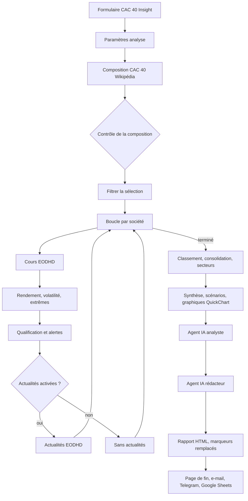

# Luscene Blériot – Projets

Dépôt regroupant mes projets d'automatisation et de création de contenu : des **workflows n8n**, des **skills Claude** réutilisables et des **ressources vidéo**.

> Dépôt public. Aucun identifiant, clé d'API ni jeton n'est versionné ici : ils restent dans n8n ou dans la configuration locale de chacun.

## Sommaire

- [Organisation du dépôt](#organisation-du-dépôt)
- [Les skills Claude](#les-skills-claude)
  - [Comment fonctionne un skill](#comment-fonctionne-un-skill)
  - [Installer un skill](#installer-un-skill)
  - [interview](#interview)
  - [doubt-driven-dev](#doubt-driven-dev)
  - [hostile-review](#hostile-review)
  - [Enchaîner les skills](#enchaîner-les-skills)
- [Projet : CAC 40 Insight AI](#projet--cac-40-insight-ai)
  - [Ce que fait le workflow](#ce-que-fait-le-workflow)
  - [Architecture](#architecture)
  - [Étape par étape](#étape-par-étape)
  - [Formules de calcul](#formules-de-calcul)
  - [Agents IA et prompts](#agents-ia-et-prompts)
  - [Captures d'écran](#captures-décran)
  - [Mise en place](#mise-en-place)
  - [Limites connues](#limites-connues)

## Organisation du dépôt

| Dossier | Contenu |
|---|---|
| [`workflow/`](workflow/) | Workflows n8n exportés (JSON) et leur source TypeScript |
| [`skills/`](skills/) | Skills Claude, chacun dans son dossier avec un fichier `SKILL.md` |
| [`video/`](video/) | Vidéos et ressources vidéo |

---

## Les skills Claude

Un **skill** est un petit paquet d'instructions que Claude Code charge au moment où il en a besoin. Il ne s'exécute pas tout seul : Claude lit ses consignes et les applique à la tâche en cours.

### Comment fonctionne un skill

Chaque skill est un dossier contenant un fichier `SKILL.md`, composé de deux parties :

1. **Un en-tête** entre deux lignes `---`, avec un `name` et une `description`. C'est la `description` qui décide quand Claude charge le skill : elle liste les situations et les phrases qui le déclenchent (« interview-moi », « hostile review », etc.). Claude lit cet en-tête pour savoir si le skill est pertinent ; le reste n'est chargé qu'une fois le skill choisi.
2. **Le corps** en Markdown : les règles, la méthode pas à pas et le format de sortie attendu.

Un skill peut être déclenché de deux façons :
- **automatiquement**, quand la demande correspond à sa description ;
- **explicitement**, en tapant `/nom-du-skill` (par exemple `/interview`).

### Installer un skill

Copie le dossier du skill dans ton dossier personnel de skills, puis relance Claude Code. Le skill doit se trouver à `~/.claude/skills/<nom>/SKILL.md`.

```bash
# Windows (PowerShell)
Copy-Item -Recurse skills\interview "$env:USERPROFILE\.claude\skills\interview"

# macOS / Linux
cp -r skills/interview ~/.claude/skills/interview
```

Répète l'opération pour `doubt-driven-dev` et `hostile-review`.

### interview

**Pour quoi faire :** transformer une idée floue en spécification claire, **avant** d'écrire la moindre ligne de code.

**Quand il se déclenche :** « interview-moi », « pose-moi des questions », « aide-moi à préciser mon idée », ou toute demande de fonctionnalité trop vague pour être exécutée sans deviner.

**Fonctionnement :**
1. Claude lit le contexte disponible (README, structure du projet, fichiers concernés) pour ne pas poser de questions dont la réponse est déjà dans le code.
2. Il reformule la demande en une phrase.
3. Il pose **une seule question à la fois**, de préférence sous forme d'options A / B / C avec sa recommandation.
4. Il progresse du général au détail : **le pourquoi** (problème, public, situation actuelle), **le périmètre** (ce qui est inclus et surtout ce qui est exclu), **le comportement** (parcours principal, cas limites, erreurs, données vides), puis **les contraintes** (technologie imposée, performance, sécurité).
5. Il ne code rien et ne crée aucun fichier tant que la spécification n'est pas validée.

**Sortie :** une spécification au format suivant :

```markdown
# Spec : <titre>
## Problème
## Objectif
## Périmètre
## Comportement attendu
## Cas limites et erreurs
## Contraintes
## Critères d'acceptation
## Questions encore ouvertes
```

### doubt-driven-dev

**Pour quoi faire :** développer avec méthode quand un bug est difficile, quand le code est critique, ou quand une solution « qui marchait » s'est révélée fausse. Le principe : **tout ce que tu crois est suspect tant que tu ne l'as pas vérifié**, y compris ta mémoire, la documentation, les noms de fonctions et les tests qui passent.

**Quand il se déclenche :** « doubt-driven dev », « développement rigoureux », un bug difficile, du code critique.

**Les cinq règles :**
1. **Pas d'affirmation sans preuve.** Interdit de dire « ça marche » sans avoir exécuté quelque chose qui le montre : la commande et sa sortie doivent être citées.
2. **Vérifier avant d'utiliser.** Une API, une option, une version : on lit le code ou la doc réelle du projet.
3. **Un test qui n'a jamais échoué ne prouve rien.** On écrit le test, on vérifie qu'il échoue pour la bonne raison, puis on le fait passer.
4. **Douter de son propre correctif.** Après une correction, on se demande si l'on a corrigé le symptôme plutôt que la cause, et on reproduit le bug d'origine.
5. **Distinguer** ce qui est *vérifié*, *supposé* et *inconnu*.

**La boucle de travail, pour chaque étape :**
1. **Hypothèses** : lister ce qui conditionne la solution, chacune marquée « non vérifié » au départ ;
2. **Vérification** : trouver le moyen le moins cher de confirmer ou d'infirmer chaque hypothèse critique (lire le code, un script d'une ligne, un test, un log) ;
3. **Changement minimal** : modifier le moins de choses possible, une à la fois ;
4. **Preuve** : exécuter et montrer le résultat. Si le résultat surprend, s'arrêter et comprendre avant de continuer ;
5. **Contre-examen** : chercher activement ce qui peut encore casser (entrée vide, null, gros volume, concurrence, Windows et Linux, encodage).

**Rapport final :** trois listes, « Vérifié », « Supposé (non vérifié) » et « Risques restants », puis un niveau de confiance (faible, moyen ou élevé) avec sa justification.

### hostile-review

**Pour quoi faire :** trouver ce qui va casser en production **avant** que ça arrive. Le code est considéré comme faux jusqu'à preuve du contraire. La critique vise le code, jamais la personne : pas de moqueries, mais aucun compliment ni formule pour adoucir.

**Quand il se déclenche :** « hostile review », revue sans pitié ou adversariale, « démonte » ou « casse » mon code, un diff, une PR ou un fichier.

**Fonctionnement :**
1. **Cibler** : le fichier, la PR ou le diff fourni. À défaut, les changements en cours (`git diff`, puis `git diff --staged`). Claude lit aussi le code autour (appelants, fonctions appelées, tests), car les bugs se cachent souvent aux frontières.
2. **Attaquer** chaque morceau sous plusieurs angles : exactitude (décalages d'un, conditions inversées, valeurs de retour ignorées), entrées hostiles (vide, null, négatif, très grand, unicode, caractères spéciaux), erreurs mal gérées, concurrence, sécurité, performance.
3. **Prouver** : chaque problème doit venir avec **l'entrée ou la situation exacte** qui produit le mauvais résultat, idéalement un petit test qui le démontre. Une remarque sans scénario concret est abandonnée ou classée « à vérifier ».
4. **Rapporter** par niveau de gravité :
   - 🔴 **Critique** : bug certain, faille, perte de données ;
   - 🟠 **Majeur** : cassera dans des cas réalistes ;
   - 🟡 **Mineur** : fragilité, dette, lisibilité qui cache un risque ;
   - ❓ **À vérifier** : soupçon sans preuve.

Chaque point indique le fichier et la ligne.

### Enchaîner les skills

Les trois skills se complètent dans un ordre naturel :

```
interview            →  on sait ce qu'on construit (spec validée)
      ↓
doubt-driven-dev     →  on le construit en vérifiant chaque hypothèse
      ↓
hostile-review       →  on attaque le résultat avant de le livrer
```

---

## Projet : CAC 40 Insight AI

Un **workflow n8n unique** qui analyse les **40 sociétés du CAC 40** sur un mois glissant, à partir de **cours de clôture réels** et d'une **composition de l'indice actualisée à chaque exécution**. Le rapport final est rédigé en français par **Gemini**, qui ne reçoit que des données déjà calculées par le workflow.

> Projet pédagogique. Le rapport ne constitue pas un conseil en investissement.

### Ce que fait le workflow

- **Périmètre au choix** : les 40 sociétés, ou une sélection personnalisée dans le formulaire.
- **Composition vérifiée** : la liste des sociétés est lue depuis la page Wikipédia du CAC 40 à chaque exécution, puis comparée à une liste de contrôle. Si la lecture échoue ou si la liste est incohérente, le workflow le signale et utilise la liste de contrôle.
- **Cours réels** : clôtures quotidiennes ajustées (dividendes et divisions) fournies par EODHD.
- **Indicateurs par société** : rendement sur la période, volatilité annualisée, baisse maximale, écart au plus haut, et alertes selon des seuils configurables.
- **Analyse par secteur** : rendement moyen, meilleur et plus faible titre, volatilité moyenne et liste des sociétés, pour chaque secteur.
- **Comptages fiables** : hausses, baisses, dépassements de seuils et alertes par type sont calculés par le workflow et transmis aux agents, qui doivent les recopier sans les recompter.
- **Rapport complet** : 11 sections, tableaux, graphiques QuickChart (rendements, secteurs, cours en euros sur échelle logarithmique) et scénarios hypothétiques.
- **Diffusion** : page de rapport à la fin du formulaire, e-mail Gmail facultatif, résumé et graphique envoyés sur Telegram, et ligne ajoutée à un historique Google Sheets.

### Architecture



Le workflow est un seul fichier. Il ne contient **aucun nœud Code** : tous les traitements passent par des nœuds natifs de n8n, ce qui le rend plus lisible et plus facile à maintenir.

### Étape par étape

1. **Formulaire** : choix du périmètre (40 sociétés ou sélection), période, modules activés (comparaison, risques, actualités, scénario) et e-mail facultatif.
2. **Paramètres** : seuils d'alerte, identifiant de la feuille Google Sheets et date d'exécution, regroupés dans un seul nœud.
3. **Composition** : lecture du tableau des constituants sur Wikipédia (API MediaWiki), nettoyage des noms, puis contrôle par rapport à la liste de contrôle locale. Le résultat indique la source, la révision Wikipédia et les entrées ou sorties éventuelles.
4. **Boucle par société** : pour chaque société, une pause limite le débit, les cours sont téléchargés, contrôlés, puis les indicateurs sont calculés.
5. **Actualités** (si activées) : jusqu'à cinq appels EODHD par société, avec les titres et la polarité fournie par EODHD.
6. **Consolidation** : fusion des résultats et des secteurs, dates communes, statistiques du panier (moyenne équipondérée, médiane, hausses et baisses), scénarios.
7. **Agents IA** : l'analyste produit une analyse structurée, puis le rédacteur écrit le rapport à partir de cette analyse et des données calculées.
8. **Diffusion** : rapport HTML, e-mail, résumé Telegram (au-delà de six sociétés, seuls les trois meilleurs et les trois plus faibles sont listés) et ligne d'historique dans Google Sheets.

### Formules de calcul

- **Rendement** (%) = (cours final / cours initial − 1) × 100. Calculé seulement si le cours initial est strictement positif et qu'il y a au moins deux cotations. Arrondi à deux décimales.
- **Volatilité annualisée** (%) = écart-type échantillon des rendements logarithmiques quotidiens × √252 × 100.
- **Baisse maximale** (%) = minimum, sur la période, de (cours / plus haut atteint jusque-là − 1) × 100.
- **Classement** : seules sont classées les sociétés dont la qualité est « OK » et dont les dates initiale et finale sont les dates communes les plus fréquentes. Les autres sont listées à part comme non comparables.
- **Scénarios hypothétiques** (sans probabilité ni cours cible) : variation du panier équipondéré = k × σ mensuelle, avec σ mensuelle = volatilité annualisée moyenne × √(21/252), et k égal à +1 (favorable), 0 (central) ou −1 (défavorable).

### Agents IA et prompts

Le workflow contient deux vrais nœuds **AI Agent**, chacun relié à un sous-nœud **Google Gemini Chat Model** :

| Agent | Modèle | Outils | Sortie |
|---|---|---|---|
| **Agent IA analyste** | Gemini (température 0,1) | Calculatrice, Réflexion | Objet JSON imposé par « Format JSON de l’analyse » |
| **Agent IA rédacteur** | Gemini (température 0,2) | Réflexion du rédacteur | Markdown en 11 sections avec marqueurs |

Chaque agent a un **prompt système** (Options → System Message) et un **prompt utilisateur** (champ « Prompt »), visibles directement dans le nœud. Le prompt système est écrit au format XML : rôle, objectif, contexte, exemples, format de sortie et entrées.

Règles communes aux deux agents :
- utiliser uniquement les données fournies, sans connaissance extérieure ;
- ne jamais inventer un chiffre, une date, une société, un article ou une cause ;
- recopier les comptages de l'objet `compteurs`, sans les recalculer ;
- distinguer les faits des interprétations ;
- ne jamais présenter une actualité comme la cause d'un mouvement de cours ;
- ne donner aucune recommandation, aucun cours cible et aucune probabilité.

Chaque prompt contient **cinq exemples** : trois proches du projet (sélection de trois sociétés, analyse complète avec échecs, période avec alertes) et deux fictifs, marqués comme illustratifs. Les exemples fictifs évitent que le modèle reprenne des noms ou des chiffres d'exemple dans un rapport réel.

### Captures d'écran

Les captures ne sont pas encore ajoutées. Pour les inclure, place-les dans `docs/images/` puis remplace ce tableau :

| Capture | Ce qu'elle montre |
|---|---|
| `docs/images/canvas.png` | Vue d'ensemble du canevas n8n |
| `docs/images/agents.png` | Les deux agents IA, leurs modèles et leurs outils |
| `docs/images/rapport.png` | Une page de rapport générée |
| `docs/images/telegram.png` | Le résumé envoyé sur Telegram |

### Mise en place

**Prérequis**
- Une instance n8n récente (n8n Cloud ou auto-hébergée), avec Form Trigger 2.6, HTTP Request 4.5, Edit Fields 3.5, AI Agent 3.1 et Google Gemini Chat Model 1.2 ;
- une clé d'API **EODHD** (https://eodhd.com) ;
- une clé **Google AI Studio** pour Gemini ;
- *facultatif* : un compte Gmail connecté à n8n, pour l'envoi par e-mail ;
- *facultatif* : un bot Telegram et l'identifiant de la discussion.

**Identifiants à créer dans n8n**
1. **Requête EODHD** (Query Auth) : paramètre `api_token`, valeur = ta clé EODHD. Utilisé par « Cours historiques EODHD » et « Actualités EODHD ».
2. **Google Gemini (PaLM) API** : ta clé Google AI Studio. Utilisé par les deux modèles Gemini.
3. **Gmail** (facultatif) : connexion OAuth2.
4. **Google Sheets** : connexion OAuth2, et feuille de destination indiquée par `googleSheetId` dans « Paramètres analyse ».
5. **Telegram** (facultatif) : jeton du bot. L'identifiant de discussion se renseigne dans « Paramètres analyse », champ `telegramChatId`.

Aucun de ces secrets n'est écrit dans le dépôt.

**Importer le workflow**
1. Dans n8n, crée un workflow vide, puis choisis **Importer depuis un fichier** et sélectionne `workflow.json`.
2. Crée les identifiants ci-dessus et associe-les aux nœuds concernés.
3. Renseigne `googleSheetId` (et `telegramChatId` si tu utilises Telegram) dans « Paramètres analyse ».
4. Lance l'exécution depuis le formulaire, avec une sélection de trois sociétés pour un premier test.

**Vérifier le code source** (si tu modifies `workflow.ts`) :

```bash
npm install
npm run typecheck     # vérification TypeScript
npm run export        # génère workflow.json et vérifie l'absence de nœud Code et de secret
npm run parse-check   # vérifie que workflow.json correspond à workflow.ts
```

### Limites connues

- Les données sont des **clôtures quotidiennes**, pas du temps réel.
- La composition vient de Wikipédia en anglais : les noms de secteurs restent en anglais dans les tableaux.
- La volatilité sur un mois est une estimation très imparfaite : elle ne dit rien du risque à long terme.
- Les actualités servent seulement à contextualiser : aucune corrélation n'est établie avec les cours.
- Les modèles Gemini peuvent se tromper malgré les consignes. Les comptages et les chiffres sont donc calculés par le workflow, et non par le modèle.
