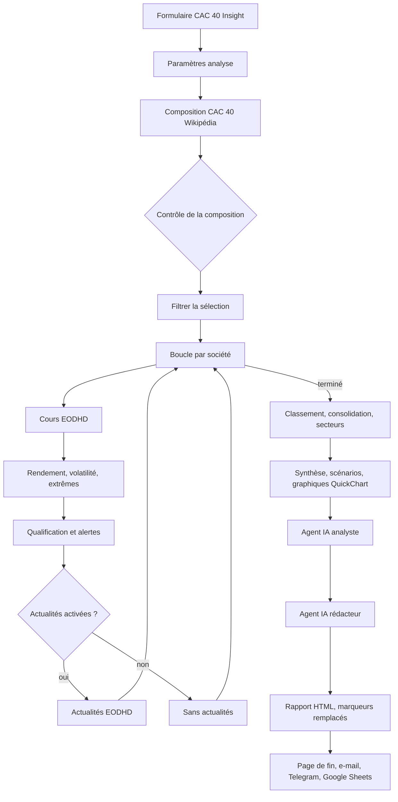

# Luscene Blériot – Projets

Dépôt regroupant mes projets d'automatisation et de création de contenu : des **workflows n8n**, des **skills Claude** réutilisables et des **ressources vidéo**.

> Dépôt public. Aucun identifiant, clé d'API ni jeton n'est versionné ici : ils restent dans n8n ou dans la configuration locale de chacun.

## Sommaire

- [Organisation du dépôt](#organisation-du-dépôt)
- [Les skills Claude](#les-skills-claude)
  - [Vue d'ensemble](#vue-densemble)
  - [Installation](#installation)
  - [interview](#interview)
  - [doubt-driven-dev](#doubt-driven-dev)
  - [hostile-review](#hostile-review)
  - [Enchaîner les skills](#enchaîner-les-skills)
- [Projet : CAC 40 Insight AI](#projet--cac-40-insight-ai)
  - [Ce que fait le workflow](#ce-que-fait-le-workflow)
  - [Architecture](#architecture)
  - [Étape par étape](#étape-par-étape)
  - [Formules de calcul](#formules-de-calcul)
  - [Agents IA et prompts](#agents-ia-et-prompts)
  - [Captures d'écran](#captures-décran)
  - [Mise en place](#mise-en-place)
  - [Limites connues](#limites-connues)

## Organisation du dépôt

| Dossier | Contenu |
|---|---|
| [`workflow/`](workflow/) | Workflows n8n exportés (JSON) et leur source TypeScript |
| [`skills/`](skills/) | Skills Claude, chacun dans son dossier avec un fichier `SKILL.md` |
| [`video/`](video/) | Vidéos et ressources vidéo |

---

## Les skills Claude

Les skills sont des modules d'instructions que Claude Code charge automatiquement lorsqu'une demande correspond à leur description. Ce dépôt en contient trois, conçus pour se compléter : **cadrer** une demande, **construire** avec des preuves, puis **contrôler** le résultat.

### Vue d'ensemble

| Skill | Rôle | Déclenchement typique | Résultat |
|---|---|---|---|
| [`interview`](skills/interview/SKILL.md) | Cadrer une demande floue | « interview-moi », « pose-moi des questions » | Spécification validée |
| [`doubt-driven-dev`](skills/doubt-driven-dev/SKILL.md) | Développer en vérifiant chaque hypothèse | « doubt-driven dev », bug difficile, code critique | Bilan : vérifié, supposé, risques restants |
| [`hostile-review`](skills/hostile-review/SKILL.md) | Chercher ce qui va casser | « hostile review », « démonte mon code » | Rapport classé par gravité |

### Structure d'un skill

```
skills/
└── interview/
    └── SKILL.md
```

Chaque `SKILL.md` comporte deux parties :

- **un en-tête** (`name`, `description`) : Claude s'en sert pour décider si le skill est pertinent. La `description` énumère les phrases et situations qui déclenchent le skill ;
- **un corps** en Markdown : la méthode à suivre, les règles et le format de sortie. Il n'est chargé que lorsque le skill est retenu.

Un skill s'active de deux façons : **automatiquement**, selon sa description, ou **explicitement** avec la commande `/nom-du-skill`, par exemple `/hostile-review`.

### Installation

Copie le dossier du skill dans `~/.claude/skills/`, puis relance Claude Code.

```bash
# Windows (PowerShell)
Copy-Item -Recurse skills\interview "$env:USERPROFILE\.claude\skills\interview"

# macOS / Linux
cp -r skills/interview ~/.claude/skills/interview
```

Répète l'opération pour `doubt-driven-dev` et `hostile-review`.

### interview

**Objectif.** Transformer une idée floue en spécification claire, avant toute ligne de code.

**Méthode.**
1. Claude consulte le contexte disponible (README, structure du projet, fichiers concernés) afin de ne pas poser de question dont la réponse figure déjà dans le code.
2. Il reformule la demande en une phrase pour validation.
3. Il pose **une question à la fois**, si possible sous forme d'options (A, B, C) assorties d'une recommandation.
4. Il couvre successivement le **pourquoi** (problème, public, situation actuelle), le **périmètre** (inclus et exclu), le **comportement** (parcours principal, cas limites, erreurs) et les **contraintes** (technique, performance, sécurité).

**Garde-fou.** Aucun code et aucun fichier ne sont produits tant que la spécification n'est pas validée.

**Résultat.** Une spécification structurée :

```markdown
# Spec : <titre>
## Problème
## Objectif
## Périmètre
## Comportement attendu
## Cas limites et erreurs
## Contraintes
## Critères d'acceptation
## Questions encore ouvertes
```

**Exemple.** Demande : « Je veux une application de suivi de dépenses. » → Claude commence par demander quel problème elle doit résoudre et pour qui, puis fixe le périmètre avant de proposer une spécification.

### doubt-driven-dev

**Objectif.** Développer sans rien tenir pour acquis. Chaque hypothèse est listée, vérifiée, puis seulement ensuite utilisée. Ce skill convient aux bugs difficiles, au code critique et aux situations où une solution « qui marchait » s'est révélée fausse.

**Règles.**
1. Aucune affirmation sans preuve : la commande et sa sortie doivent être citées.
2. Vérifier avant d'utiliser : une API, une option ou une version se contrôle dans le code ou la documentation du projet, pas de mémoire.
3. Un test qui n'a jamais échoué ne prouve rien : il doit d'abord échouer pour la bonne raison.
4. Douter de son correctif : reproduire le bug d'origine pour confirmer que la cause, et non le symptôme, a été traitée.
5. Distinguer ce qui est vérifié, supposé et inconnu.

**Boucle de travail.** Pour chaque étape : formuler les hypothèses → vérifier les plus critiques par le moyen le moins coûteux → modifier le minimum → exécuter et montrer le résultat → chercher activement les cas qui peuvent encore échouer (entrée vide, `null`, volume élevé, concurrence, Windows et Linux, encodage).

**Résultat.** Un bilan en trois listes (**vérifié**, **supposé non vérifié**, **risques restants**) et un niveau de confiance (faible, moyen ou élevé), justifié en une phrase.

### hostile-review

**Objectif.** Trouver les défauts d'un code avant qu'ils n'atteignent la production. Le code est considéré comme défectueux tant qu'il n'a pas prouvé le contraire. La critique porte sur le code, jamais sur la personne, et ne contient ni compliment ni formule d'adoucissement.

**Méthode.**
1. **Périmètre** : le fichier, la PR ou le diff indiqué ; à défaut, les modifications en cours (`git diff`, puis `git diff --staged`). Le code qui entoure les modifications (appelants, fonctions appelées, tests) est également lu.
2. **Angles d'attaque** : exactitude, entrées hostiles, gestion des erreurs, concurrence, sécurité, performance.
3. **Preuve** : chaque problème doit être accompagné de l'entrée ou de la situation qui le déclenche, idéalement d'un test qui le démontre. Une remarque sans scénario concret est retirée ou classée « à vérifier ».

**Niveaux de gravité.**

| Niveau | Signification |
|---|---|
| 🔴 Critique | Bug certain, faille de sécurité, perte de données |
| 🟠 Majeur | Défaillance dans des cas réalistes |
| 🟡 Mineur | Fragilité, dette technique, lisibilité qui masque un risque |
| ❓ À vérifier | Soupçon sans preuve à ce stade |

Chaque point indique le fichier et la ligne concernés.

### Enchaîner les skills

```
interview  →  spécification validée
     ↓
doubt-driven-dev  →  implémentation vérifiée étape par étape
     ↓
hostile-review  →  contrôle final avant livraison
```

---

## Projet : CAC 40 Insight AI

Un **workflow n8n unique** qui analyse les **40 sociétés du CAC 40** sur un mois glissant, à partir de **cours de clôture réels** et d'une **composition de l'indice actualisée à chaque exécution**. Le rapport final est rédigé en français par **Gemini**, qui ne reçoit que des données déjà calculées par le workflow.

> Projet pédagogique. Le rapport ne constitue pas un conseil en investissement.

### Ce que fait le workflow

- **Périmètre au choix** : les 40 sociétés, ou une sélection personnalisée dans le formulaire.
- **Composition vérifiée** : la liste des sociétés est lue depuis la page Wikipédia du CAC 40 à chaque exécution, puis comparée à une liste de contrôle. Si la lecture échoue ou si la liste est incohérente, le workflow le signale et utilise la liste de contrôle.
- **Cours réels** : clôtures quotidiennes ajustées (dividendes et divisions) fournies par EODHD.
- **Indicateurs par société** : rendement sur la période, volatilité annualisée, baisse maximale, écart au plus haut, et alertes selon des seuils configurables.
- **Analyse par secteur** : rendement moyen, meilleur et plus faible titre, volatilité moyenne et liste des sociétés, pour chaque secteur.
- **Comptages fiables** : hausses, baisses, dépassements de seuils et alertes par type sont calculés par le workflow et transmis aux agents, qui doivent les recopier sans les recompter.
- **Rapport complet** : 11 sections, tableaux, graphiques QuickChart (rendements, secteurs, cours en euros sur échelle logarithmique) et scénarios hypothétiques.
- **Diffusion** : page de rapport à la fin du formulaire, e-mail Gmail facultatif, résumé et graphique envoyés sur Telegram, et ligne ajoutée à un historique Google Sheets.

### Architecture



Le workflow est un seul fichier. Il ne contient **aucun nœud Code** : tous les traitements passent par des nœuds natifs de n8n, ce qui le rend plus lisible et plus facile à maintenir.

### Étape par étape

1. **Formulaire** : choix du périmètre (40 sociétés ou sélection), période, modules activés (comparaison, risques, actualités, scénario) et e-mail facultatif.
2. **Paramètres** : seuils d'alerte, identifiant de la feuille Google Sheets et date d'exécution, regroupés dans un seul nœud.
3. **Composition** : lecture du tableau des constituants sur Wikipédia (API MediaWiki), nettoyage des noms, puis contrôle par rapport à la liste de contrôle locale. Le résultat indique la source, la révision Wikipédia et les entrées ou sorties éventuelles.
4. **Boucle par société** : pour chaque société, une pause limite le débit, les cours sont téléchargés, contrôlés, puis les indicateurs sont calculés.
5. **Actualités** (si activées) : jusqu'à cinq appels EODHD par société, avec les titres et la polarité fournie par EODHD.
6. **Consolidation** : fusion des résultats et des secteurs, dates communes, statistiques du panier (moyenne équipondérée, médiane, hausses et baisses), scénarios.
7. **Agents IA** : l'analyste produit une analyse structurée, puis le rédacteur écrit le rapport à partir de cette analyse et des données calculées.
8. **Diffusion** : rapport HTML, e-mail, résumé Telegram (au-delà de six sociétés, seuls les trois meilleurs et les trois plus faibles sont listés) et ligne d'historique dans Google Sheets.

### Formules de calcul

- **Rendement** (%) = (cours final / cours initial − 1) × 100. Calculé seulement si le cours initial est strictement positif et qu'il y a au moins deux cotations. Arrondi à deux décimales.
- **Volatilité annualisée** (%) = écart-type échantillon des rendements logarithmiques quotidiens × √252 × 100.
- **Baisse maximale** (%) = minimum, sur la période, de (cours / plus haut atteint jusque-là − 1) × 100.
- **Classement** : seules sont classées les sociétés dont la qualité est « OK » et dont les dates initiale et finale sont les dates communes les plus fréquentes. Les autres sont listées à part comme non comparables.
- **Scénarios hypothétiques** (sans probabilité ni cours cible) : variation du panier équipondéré = k × σ mensuelle, avec σ mensuelle = volatilité annualisée moyenne × √(21/252), et k égal à +1 (favorable), 0 (central) ou −1 (défavorable).

### Agents IA et prompts

Le workflow contient deux vrais nœuds **AI Agent**, chacun relié à un sous-nœud **Google Gemini Chat Model** :

| Agent | Modèle | Outils | Sortie |
|---|---|---|---|
| **Agent IA analyste** | Gemini (température 0,1) | Calculatrice, Réflexion | Objet JSON imposé par « Format JSON de l’analyse » |
| **Agent IA rédacteur** | Gemini (température 0,2) | Réflexion du rédacteur | Markdown en 11 sections avec marqueurs |

Chaque agent a un **prompt système** (Options → System Message) et un **prompt utilisateur** (champ « Prompt »), visibles directement dans le nœud. Le prompt système est écrit au format XML : rôle, objectif, contexte, exemples, format de sortie et entrées.

Règles communes aux deux agents :
- utiliser uniquement les données fournies, sans connaissance extérieure ;
- ne jamais inventer un chiffre, une date, une société, un article ou une cause ;
- recopier les comptages de l'objet `compteurs`, sans les recalculer ;
- distinguer les faits des interprétations ;
- ne jamais présenter une actualité comme la cause d'un mouvement de cours ;
- ne donner aucune recommandation, aucun cours cible et aucune probabilité.

Chaque prompt contient **cinq exemples** : trois proches du projet (sélection de trois sociétés, analyse complète avec échecs, période avec alertes) et deux fictifs, marqués comme illustratifs. Les exemples fictifs évitent que le modèle reprenne des noms ou des chiffres d'exemple dans un rapport réel.

### Captures d'écran

Les captures ne sont pas encore ajoutées. Pour les inclure, place-les dans `docs/images/` puis remplace ce tableau :

| Capture | Ce qu'elle montre |
|---|---|
| `docs/images/canvas.png` | Vue d'ensemble du canevas n8n |
| `docs/images/agents.png` | Les deux agents IA, leurs modèles et leurs outils |
| `docs/images/rapport.png` | Une page de rapport générée |
| `docs/images/telegram.png` | Le résumé envoyé sur Telegram |

### Mise en place

**Prérequis**
- Une instance n8n récente (n8n Cloud ou auto-hébergée), avec Form Trigger 2.6, HTTP Request 4.5, Edit Fields 3.5, AI Agent 3.1 et Google Gemini Chat Model 1.2 ;
- une clé d'API **EODHD** (https://eodhd.com) ;
- une clé **Google AI Studio** pour Gemini ;
- *facultatif* : un compte Gmail connecté à n8n, pour l'envoi par e-mail ;
- *facultatif* : un bot Telegram et l'identifiant de la discussion.

**Identifiants à créer dans n8n**
1. **Requête EODHD** (Query Auth) : paramètre `api_token`, valeur = ta clé EODHD. Utilisé par « Cours historiques EODHD » et « Actualités EODHD ».
2. **Google Gemini (PaLM) API** : ta clé Google AI Studio. Utilisé par les deux modèles Gemini.
3. **Gmail** (facultatif) : connexion OAuth2.
4. **Google Sheets** : connexion OAuth2, et feuille de destination indiquée par `googleSheetId` dans « Paramètres analyse ».
5. **Telegram** (facultatif) : jeton du bot. L'identifiant de discussion se renseigne dans « Paramètres analyse », champ `telegramChatId`.

Aucun de ces secrets n'est écrit dans le dépôt.

**Importer le workflow**
1. Dans n8n, crée un workflow vide, puis choisis **Importer depuis un fichier** et sélectionne `workflow.json`.
2. Crée les identifiants ci-dessus et associe-les aux nœuds concernés.
3. Renseigne `googleSheetId` (et `telegramChatId` si tu utilises Telegram) dans « Paramètres analyse ».
4. Lance l'exécution depuis le formulaire, avec une sélection de trois sociétés pour un premier test.

**Vérifier le code source** (si tu modifies `workflow.ts`) :

```bash
npm install
npm run typecheck     # vérification TypeScript
npm run export        # génère workflow.json et vérifie l'absence de nœud Code et de secret
npm run parse-check   # vérifie que workflow.json correspond à workflow.ts
```

### Limites connues

- Les données sont des **clôtures quotidiennes**, pas du temps réel.
- La composition vient de Wikipédia en anglais : les noms de secteurs restent en anglais dans les tableaux.
- La volatilité sur un mois est une estimation très imparfaite : elle ne dit rien du risque à long terme.
- Les actualités servent seulement à contextualiser : aucune corrélation n'est établie avec les cours.
- Les modèles Gemini peuvent se tromper malgré les consignes. Les comptages et les chiffres sont donc calculés par le workflow, et non par le modèle.
