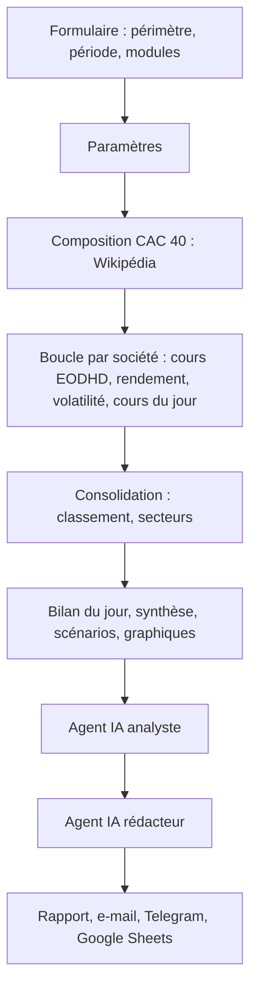

# Luscene Blériot – Projets

Dépôt regroupant mes projets d'automatisation et de création de contenu : des **workflows n8n**, des **skills Claude** réutilisables et des **ressources vidéo**.

> Dépôt public. Aucun identifiant, clé d'API ni jeton n'est versionné ici : ils restent dans n8n ou dans la configuration locale de chacun.

## Sommaire

- [Organisation du dépôt](#organisation-du-dépôt)
- [Les skills Claude](#les-skills-claude)
- [Projet : CAC 40 Insight AI](#projet--cac-40-insight-ai)

## Organisation du dépôt

| Dossier | Contenu |
|---|---|
| [`workflow/`](workflow/) | Workflow n8n CAC 40 Insight AI, défini dans `workflow.ts`, avec sa documentation |
| [`skills/`](skills/) | Skills Claude, chacun dans son dossier avec un fichier `SKILL.md` |
| [`video/`](video/) | Vidéos et ressources vidéo |

---

## Les skills Claude

Les skills sont des modules d'instructions que Claude Code charge automatiquement lorsqu'une demande correspond à leur description. Ce dépôt en contient trois, conçus pour se compléter : **cadrer** une demande, **construire** avec des preuves, puis **contrôler** le résultat.

### Vue d'ensemble

| Skill | Rôle | Déclenchement typique | Résultat |
|---|---|---|---|
| [`interview`](skills/interview/SKILL.md) | Cadrer une demande floue | « interview-moi », « pose-moi des questions » | Spécification validée |
| [`doubt-driven-dev`](skills/doubt-driven-dev/SKILL.md) | Développer en vérifiant chaque hypothèse | « doubt-driven dev », bug difficile, code critique | Bilan : vérifié, supposé, risques restants |
| [`hostile-review`](skills/hostile-review/SKILL.md) | Chercher ce qui va casser | « hostile review », « démonte mon code » | Rapport classé par gravité |

### Structure d'un skill

```
skills/
└── interview/
    └── SKILL.md
```

Chaque `SKILL.md` comporte deux parties :

- **un en-tête** (`name`, `description`) : Claude s'en sert pour décider si le skill est pertinent. La `description` énumère les phrases et situations qui déclenchent le skill ;
- **un corps** en Markdown : la méthode à suivre, les règles et le format de sortie. Il n'est chargé que lorsque le skill est retenu.

Un skill s'active de deux façons : **automatiquement**, selon sa description, ou **explicitement** avec la commande `/nom-du-skill`, par exemple `/hostile-review`.

### Installation

Copie le dossier du skill dans `~/.claude/skills/`, puis relance Claude Code.

```bash
# Windows (PowerShell)
Copy-Item -Recurse skills\interview "$env:USERPROFILE\.claude\skills\interview"

# macOS / Linux
cp -r skills/interview ~/.claude/skills/interview
```

Répète l'opération pour `doubt-driven-dev` et `hostile-review`.

### interview

**Objectif.** Transformer une idée floue en spécification claire, avant toute ligne de code.

**Méthode.**
1. Claude consulte le contexte disponible (README, structure du projet, fichiers concernés) afin de ne pas poser de question dont la réponse figure déjà dans le code.
2. Il reformule la demande en une phrase pour validation.
3. Il pose **une question à la fois**, si possible sous forme d'options (A, B, C) assorties d'une recommandation.
4. Il couvre successivement le **pourquoi** (problème, public, situation actuelle), le **périmètre** (inclus et exclu), le **comportement** (parcours principal, cas limites, erreurs) et les **contraintes** (technique, performance, sécurité).

**Garde-fou.** Aucun code et aucun fichier ne sont produits tant que la spécification n'est pas validée.

**Résultat.** Une spécification structurée :

```markdown
# Spec : <titre>
## Problème
## Objectif
## Périmètre
## Comportement attendu
## Cas limites et erreurs
## Contraintes
## Critères d'acceptation
## Questions encore ouvertes
```

**Exemple.** Demande : « Je veux une application de suivi de dépenses. » → Claude commence par demander quel problème elle doit résoudre et pour qui, puis fixe le périmètre avant de proposer une spécification.

### doubt-driven-dev

**Objectif.** Développer sans rien tenir pour acquis. Chaque hypothèse est listée, vérifiée, puis seulement ensuite utilisée. Ce skill convient aux bugs difficiles, au code critique et aux situations où une solution « qui marchait » s'est révélée fausse.

**Règles.**
1. Aucune affirmation sans preuve : la commande et sa sortie doivent être citées.
2. Vérifier avant d'utiliser : une API, une option ou une version se contrôle dans le code ou la documentation du projet, pas de mémoire.
3. Un test qui n'a jamais échoué ne prouve rien : il doit d'abord échouer pour la bonne raison.
4. Douter de son correctif : reproduire le bug d'origine pour confirmer que la cause, et non le symptôme, a été traitée.
5. Distinguer ce qui est vérifié, supposé et inconnu.

**Boucle de travail.** Pour chaque étape : formuler les hypothèses → vérifier les plus critiques par le moyen le moins coûteux → modifier le minimum → exécuter et montrer le résultat → chercher activement les cas qui peuvent encore échouer (entrée vide, `null`, volume élevé, concurrence, Windows et Linux, encodage).

**Résultat.** Un bilan en trois listes (**vérifié**, **supposé non vérifié**, **risques restants**) et un niveau de confiance (faible, moyen ou élevé), justifié en une phrase.

### hostile-review

**Objectif.** Trouver les défauts d'un code avant qu'ils n'atteignent la production. Le code est considéré comme défectueux tant qu'il n'a pas prouvé le contraire. La critique porte sur le code, jamais sur la personne, et ne contient ni compliment ni formule d'adoucissement.

**Méthode.**
1. **Périmètre** : le fichier, la PR ou le diff indiqué ; à défaut, les modifications en cours (`git diff`, puis `git diff --staged`). Le code qui entoure les modifications (appelants, fonctions appelées, tests) est également lu.
2. **Angles d'attaque** : exactitude, entrées hostiles, gestion des erreurs, concurrence, sécurité, performance.
3. **Preuve** : chaque problème doit être accompagné de l'entrée ou de la situation qui le déclenche, idéalement d'un test qui le démontre. Une remarque sans scénario concret est retirée ou classée « à vérifier ».

**Niveaux de gravité.**

| Niveau | Signification |
|---|---|
| 🔴 Critique | Bug certain, faille de sécurité, perte de données |
| 🟠 Majeur | Défaillance dans des cas réalistes |
| 🟡 Mineur | Fragilité, dette technique, lisibilité qui masque un risque |
| ❓ À vérifier | Soupçon sans preuve à ce stade |

Chaque point indique le fichier et la ligne concernés.

### Enchaîner les skills

```
interview  →  spécification validée
     ↓
doubt-driven-dev  →  implémentation vérifiée étape par étape
     ↓
hostile-review  →  contrôle final avant livraison
```

---

## Projet : CAC 40 Insight AI

Un workflow n8n qui analyse les **40 sociétés du CAC 40** à chaque lancement : cours réels, composition actualisée, rendements, **cours du jour et variations**, classement, secteurs, puis un rapport rédigé par Gemini.

> Projet pédagogique. Le rapport ne constitue pas un conseil en investissement.

### Où trouver le projet

- **Le code** : [`workflow/cac40-insight-ai/workflow.ts`](workflow/cac40-insight-ai/workflow.ts), commenté par étapes.
- **La documentation complète** : [`workflow/cac40-insight-ai/README.md`](workflow/cac40-insight-ai/README.md) (sources de données, formules, prompts des agents, identifiants à créer, limites).

### Ce que fait le workflow

- **Périmètre** : les 40 sociétés, ou une sélection.
- **Six périodes** : 1 jour (dernière séance), 1 semaine, 1 mois, 1 trimestre, 1 semestre ou 1 an glissants.
- **Cours du jour** : cours de la dernière séance en euros, variation par rapport à la séance précédente, et bilan des hausses et des baisses.
- **Indicateurs** : rendement, volatilité annualisée, baisse maximale et alertes selon des seuils configurables.
- **Secteurs et classement**, puis **scénarios hypothétiques** dont l'horizon suit la période choisie.
- **Deux agents IA Gemini** : un analyste, qui produit une analyse structurée, puis un rédacteur, qui écrit le rapport à partir des chiffres calculés.
- **Diffusion** : page de rapport, e-mail facultatif, résumé et graphique sur Telegram, historique dans Google Sheets.

### Schéma simplifié



### Lire le code

- Le fichier `workflow.ts` commence par une présentation du projet et de son déroulement.
- Les sections sont numérotées de 1 à 10, dans l'ordre d'exécution.
- Les noms des nœuds sont en français et correspondent exactement à ceux affichés dans n8n.
- Aucune clé ni identifiant personnel n'est écrit dans le fichier : ils sont créés dans n8n.

### Captures d'écran

À ajouter : vue d'ensemble du canevas n8n, les deux agents IA, une page de rapport, et le résumé Telegram.
